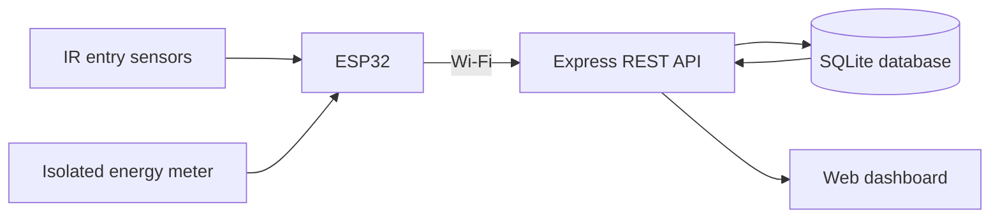

# System Architecture
1. Two low-voltage digital entry sensors estimate occupancy at a room doorway.
2. A certified isolated energy meter provides power and cumulative energy data.
3. ESP32 sends JSON through Wi-Fi to the Node.js API with an API key.
4. Express validates device readings and persists them in SQLite.
5. The dashboard polls the API and displays current room states and recent power readings.

The software demo can run without hardware. Simulation data must be identified as demo data and is not evidence of physical sensor accuracy.
